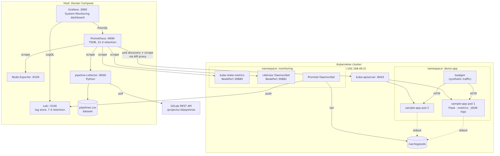

# Intelligent Observability for Kubernetes: Testbed (Phase 1)

M.Tech project: a full observability platform for a Kubernetes workload. It collects **metrics** (Prometheus with Node Exporter, cAdvisor and kube-state-metrics), **logs** (Grafana Loki + Promtail) and **CI/CD pipeline data** (Python GitLab collector), and shows them together in Grafana.

It is also the experimental testbed for the research work in [`docs/research-proposal.md`](docs/research-proposal.md): change-aware multi-signal anomaly correlation, evaluated against Prometheus threshold alerts.



## Contents

| Path | What it is |
|---|---|
| `docker-compose.yml` | Host stack: Prometheus, Loki, Grafana, Node Exporter, pipeline-collector |
| `prometheus/prometheus.yml` | Scrape jobs (host, Kubernetes, app, CI) |
| `loki/loki-config.yml` | Single-binary Loki, filesystem storage, 7-day retention |
| `grafana/provisioning/` | Datasources (Prometheus, Loki) and the **System Monitoring** dashboard |
| `k8s/app/` | Sample Flask app (`app.py`, `Dockerfile`) + Deployment, Service, load generator |
| `k8s/monitoring/` | cAdvisor DaemonSet, Helm values for kube-state-metrics and Promtail, Prometheus RBAC |
| `pipeline-collector/` | Python GitLab pipeline collector (Prometheus exporter + CSV dataset) |
| `scripts/setup.sh` | One-command bring-up (idempotent) |
| `scripts/verify.sh` | 15 automated health checks, written to `evidence/verify-output.txt` |
| `scripts/teardown.sh` | Stops everything but keeps the data |
| `scripts/gen_dashboard.py` | Generates the Grafana dashboard JSON |
| `docs/` | Architecture/workflow diagrams, testing, research proposal |
| `evidence/` | Test outputs and screenshots |

## Prerequisites

Tested on Ubuntu 26.04, 12 CPU, 5 GB RAM.

* Docker 29+ with Compose v2
* minikube 1.39 (docker driver) and kubectl 1.37
* Helm 3.19 (`~/.local/bin/helm`)
* Python 3.12. The collector runs in a container, so the host only needs Python for `gen_dashboard.py`.

## Quick start

```bash
cd ~/monitoring
./scripts/setup.sh     # minikube, app, agents, host stack (~5 min the first time)
./scripts/verify.sh    # expect: 15 passed, 0 failed
```

| URL | |
|---|---|
| http://localhost:3000 | Grafana → Dashboards → *M.Tech Project* → **System Monitoring** |
| http://localhost:9090/targets | Prometheus targets (7 up) |
| http://localhost:3100/ready | Loki |
| http://localhost:8000/metrics | CI collector metrics |
| http://192.168.49.2:30080/api/orders | Sample app (`minikube ip`) |

### Pipeline collector

```bash
# one-off summary table (default project: gitlab-org/gitlab-runner, public)
docker compose run --rm pipeline-collector python collector.py --once

# your own project: put these in .env next to docker-compose.yml
GITLAB_PROJECT_ID=<id or group/project>
GITLAB_TOKEN=<personal access token with read_api>
docker compose up -d pipeline-collector
```

Metrics exposed: `ci_pipeline_total{status}`, `ci_pipeline_success_ratio`, `ci_pipeline_duration_seconds{stat}`, `ci_pipeline_queued_seconds`, `ci_pipeline_last_status`. Every finished pipeline is appended to `pipeline-collector/data/pipelines.csv`.

### Quick failure demo

```bash
kubectl -n demo-app set env deploy/sample-app ERROR_RATE=0.5   # error spike
kubectl -n demo-app set env deploy/sample-app ERROR_RATE=0.05  # revert
```

## Phase-1 task status

| # | Task | Status |
|---|---|---|
| 1 | Architecture and workflow diagram | ✅ `docs/architecture.md` |
| 2 | Docker, Kubernetes (minikube), Python | ✅ |
| 3 | Sample application on Kubernetes | ✅ `k8s/app` |
| 4 | Prometheus installed and configured | ✅ |
| 5 | Node Exporter, cAdvisor, kube-state-metrics | ✅ |
| 6 | Grafana Loki for application and pod logs | ✅ |
| 7 | Python CI pipeline data collector (GitLab) | ✅ `pipeline-collector/` |
| 8 | Initial Grafana dashboard | ✅ 37 panels, 6 rows |
| 9 | Initial testing and evidence | ✅ `docs/testing.md`, `evidence/` (screenshots: see checklist) |

## Troubleshooting

* **Prometheus `sample-app` target down after a minikube re-create:** re-run `scripts/setup.sh`. It refreshes the API token, the CA and the minikube IP.
* **Grafana admin password:** the existing Grafana volume was reused, so the password is whatever was set before. To reset it: `docker exec grafana grafana cli admin reset-admin-password <new>`.
* **Low memory:** `kubectl -n demo-app scale deploy/sample-app --replicas=1`, or run `scripts/teardown.sh` when not in use.
