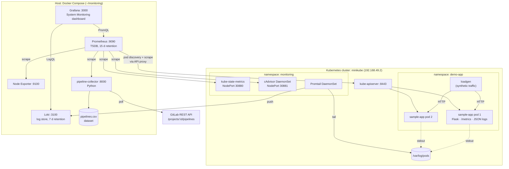
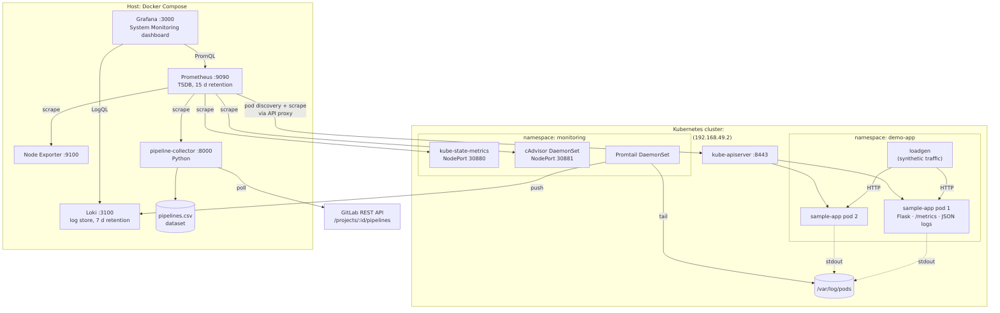
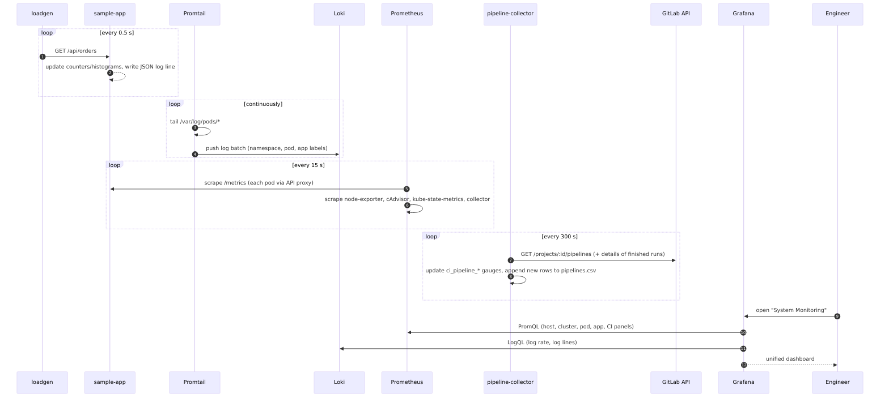
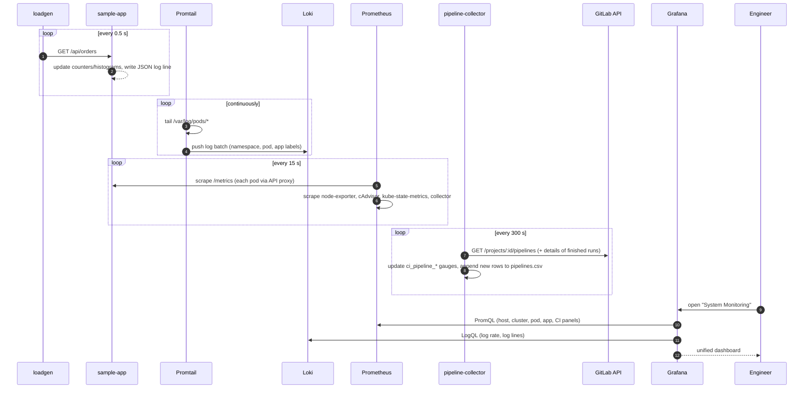
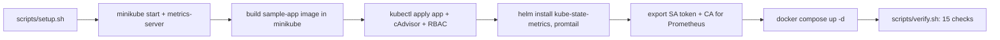

# System Architecture and Workflow

## 1. Architecture

The platform is split across two runtime environments to fit an 8 GB-class laptop (5 GB RAM usable):

* **Kubernetes (minikube, docker driver)** runs the workload under observation plus the lightweight in-cluster collectors.
* **Docker Compose on the host** runs the storage, query and visualisation layer.

### Components

| Layer | Component | Runs in | Purpose |
|---|---|---|---|
| Workload | sample-app (2 replicas) | minikube, `demo-app` | Flask order service. Exposes RED metrics (rate, errors, duration) and writes JSON logs. Injects 5 % errors. |
| Workload | loadgen | minikube, `demo-app` | Constant synthetic traffic (~2 req/s) |
| Metrics | Node Exporter | host | Host CPU, memory, disk, network |
| Metrics | cAdvisor | minikube DaemonSet | Per-container/pod CPU, memory, network |
| Metrics | kube-state-metrics | minikube (Helm) | Kubernetes object state: pods, deployments, restarts, nodes |
| Metrics | Prometheus | host | Scrapes and stores all metrics |
| Logs | Promtail | minikube DaemonSet (Helm) | Tails every pod log and adds k8s labels |
| Logs | Loki | host | Stores and indexes logs by label |
| CI/CD | pipeline-collector | host | Polls GitLab pipelines. Exposes `ci_pipeline_*` metrics and writes CSV. |
| Visualisation | Grafana | host | Dashboards over Prometheus + Loki |

### Network paths and ports

| From → To | Path | Why it's done this way |
|---|---|---|
| Prometheus → sample-app pods | `https://192.168.49.2:8443/api/v1/namespaces/demo-app/pods/<pod>:8080/proxy/metrics` | Pod IPs are not routable from the host. Scraping through the Service would mix counters of different pods. Uses a read-only ServiceAccount limited to `demo-app`. |
| Prometheus → kube-state-metrics / cAdvisor | NodePort 30880 / 30881 | Single-node cluster, so a NodePort reaches exactly one instance |
| Prometheus container → minikube network | Prometheus is attached to the `minikube` docker network | Docker isolates bridge networks from each other by default |
| Promtail → Loki | `http://host.minikube.internal:3100` | minikube's alias for the host gateway |

| Port | Service |
|---|---|
| 3000 | Grafana |
| 9090 | Prometheus |
| 3100 | Loki |
| 9100 | Node Exporter |
| 8000 | pipeline-collector |
| 30080 | sample-app (NodePort) |
| 30880 | kube-state-metrics (NodePort) |
| 30881 | cAdvisor (NodePort) |

## 2. Workflow (data flow)

## 3. Deployment workflow

