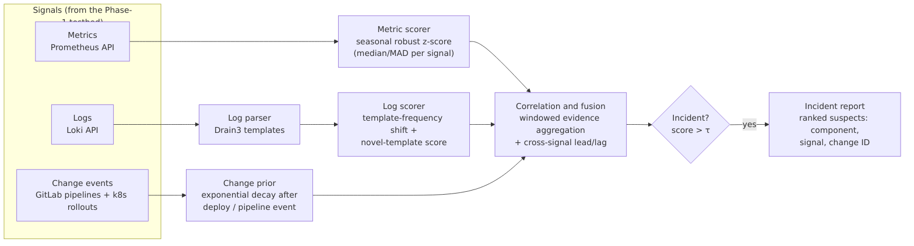

# Mid-Semester Progress Report

**Title:** Change-Aware Multi-Signal Anomaly Correlation for Failure Detection in Kubernetes
**Student:** Chaitanya · **Programme:** M.Tech · **Repository:** https://github.com/chaitanya0807/devopsproject

This report answers the review comments on the proposal. It covers:
- the proposed intelligence method
- the experimental design
- the baseline implementation
- the failure-injection dataset
- initial comparative results

The Phase-1 observability platform (see `README.md`, `docs/architecture.md`) serves as the experimental testbed.

---

## 1. Problem and contribution

Kubernetes teams usually detect failures with **static, single-signal Prometheus threshold alerts**. These alerts have three weaknesses:
1. A single incident fires many independent alerts, and benign fluctuations fire false ones.
2. The thresholds and `for:` durations are conservative, so detection is slow.
3. The alerts are blind to *changes* (deployments, config), even though changes are the most common trigger of production incidents. So the alert says *what* is wrong but not *why*.

**Contribution.** This thesis contributes four things:
1. **CAMSAC**, a lightweight online model that correlates metric anomalies, log-template anomalies and CI/CD change events to detect incidents and rank their root cause.
2. A reproducible, **labelled failure-injection benchmark** for a Kubernetes microservice: 8 fault types, ground truth, and benign changes as negative controls.
3. An **evaluation protocol** (event-level P/R/F1, false alarms per hour, window FPR, MTTD, MTTR, attribution accuracy) that compares CAMSAC with real Prometheus threshold alerts and other baselines.
4. An open-source implementation integrated with Prometheus, Loki and GitLab APIs.

**Hypotheses**
* **H1:** CAMSAC achieves a higher F1 and fewer false alarms than threshold alerts (B1) and than single-signal detectors (B2, B3).
* **H2:** CAMSAC detects failures earlier (lower MTTD) than B1.
* **H3:** Change-awareness improves root-cause attribution for change-induced failures. This is tested with the "CAMSAC − change prior" ablation.

## 2. Proposed method: CAMSAC

Implementation: `experiments/camsac.py`. Every 15 s window is scored using **only past data**, so the method can run online.

| Stage | What it does | Why |
|---|---|---|
| **1. Metric scorer** | For 8 service signals (request rate, 5xx ratio, p95 latency, max pod CPU, max pod memory, restarts, unavailable replicas, dependency traffic), it computes a robust z-score against a **trailing 20-min median/MAD baseline**, leaving out the latest minute. The z-score is mapped to [0, 1]. Each signal has a direction (e.g. only increases in errors are bad) and a noise floor. | Median/MAD is insensitive to outliers and adapts to the load pattern, unlike a fixed threshold |
| **2. Log scorer** | Drain3 mines log templates online. Three scores are computed per window: (a) the error-line ratio z-score, (b) the share of lines whose template is **rare or new** relative to the baseline, and (c) the **Jensen–Shannon divergence** of the template mix against the baseline. | Logs reveal *new* failure modes (a new exception, a dependency error) before or without any metric change |
| **3. Change prior** | Each CD event (deploy, config change, rollback) from the change feed adds a prior `exp(−Δt/λ)`, with λ = 180 s | Encodes "recent change ⇒ higher incident likelihood" |
| **4. Correlation and fusion** | Logistic model over cross-signal features: max metric score, the **number of agreeing metrics**, the log score, **metric × log**, **change × anomaly**, change × log, and change alone. Learned on training runs only. | Agreement between independent signals suppresses single-signal noise, and the change interaction lets a benign change pass while promoting a change followed by anomalies |
| **5. Alarm** | Incident probability > τ for K = 2 consecutive windows (30 s). τ is tuned on training runs. | Debouncing |
| **6. Attribution** | Ranks root-cause classes {change, app, cpu, memory, availability, dependency}. Each class gets its mean group score, a **precedence bonus** for cause signals that cross the threshold no later than the first symptom (lead/lag), and a change score `change prior × anomaly`. | Gives the operator a ranked list of suspects |

## 3. Failure-injection dataset

Harness: `experiments/run_experiment.py`. Fault hooks live in the app (`k8s/app/app.py`) and are reached through the Kubernetes API proxy. The faults are deliberately **not logged**, so the ground truth cannot leak into the log signal.

| Fault | Mechanism | Root-cause class |
|---|---|---|
| error_spike | +30 % 5xx responses on all pods | app |
| latency | +700 ms on all pods | app |
| cpu_saturation | busy-loop threads in one pod (CPU throttled at its 250 m limit) | cpu |
| memory_leak | 3 MB/s leak in one pod → OOMKilled, repeats after each restart | memory |
| crash_loop | one pod fails at startup on every restart | availability |
| bad_deploy | **release 1.1.0** with an unhandled-exception bug (35 % of requests); rolled back afterwards | change |
| dependency_down | downstream `payments` service scaled to 0 | dependency |
| config_error | **config change** `PAYMENT_TIMEOUT_MS=25`, which makes the payment calls time out | change |
| *benign change* (negative control) | 2 healthy releases per run, placed in the cool-downs | none (must not alarm) |

Each run has:
- 8 min warm-up
- the 8 faults in a **seeded random order**, each lasting 120 s
- a 210 s cool-down after each fault
- 2 benign deployments

That is about 55 min per run. The harness records `labels.csv` (fault, target, start, end, root-cause class) and `changes.jsonl` (the CD feed that the detectors see). `experiments/export.py` then exports every run from Prometheus and Loki into `metrics.csv`, `alerts.csv` and `logs.jsonl`, so **all methods are evaluated offline on identical data**.

The real-world GitLab pipeline dataset collected in Phase 1 (`pipeline-collector/data/pipelines.csv`) adds CI/CD behaviour from a large public project.

## 4. Baselines

| ID | Method | Implementation |
|---|---|---|
| **B1** | **Prometheus static threshold alerts**: error ratio > 5 % for 1 m, p95 > 500 ms for 1 m, CPU > 80 % of limit for 1 m, memory > 90 % for 30 s, pod restarted, replicas mismatch for 1 m, traffic drop | `prometheus/rules/baseline.yml`. These are real alerts evaluated by Prometheus; their `ALERTS` firing series is exported. |
| B2 | Metric-only robust z-score | CAMSAC stage 1 alone, with a tuned threshold |
| B3 | Log-only Drain3 detector | CAMSAC stage 2 alone, with a tuned threshold |
| B4 | Isolation Forest (ML) on the 8 raw metrics | scikit-learn, trained on normal windows of the training runs |
| Ablations | CAMSAC − change prior, CAMSAC − logs | Measure the contribution of each signal |

## 5. Experimental design and controls

* **Identical conditions:**
  - same image versions and resource limits
  - 15 s scrape and rule-evaluation interval
  - single-node minikube with 2 CPU
  - deterministic load profile: alternating 60 s high and 60 s low load, so the detectors must cope with normal variation
* **Randomisation:** the fault order and pod targets are seeded per run (seed = run number).
* **Warm-up** of 8 min before any fault, and cool-downs that let the system recover between faults.
* **Negative controls:** the benign deployments test that change-awareness doesn't create false alarms on its own.
* **Evaluation:** leave-one-run-out cross-validation. CAMSAC's weights and every threshold (B2–B4 and CAMSAC) are tuned only on the other runs. B1 uses its fixed, standard thresholds.
* **Statistics:** mean and spread over runs. A Wilcoxon signed-rank test on per-run F1 is run when ≥ 5 runs are available.

## 6. Evaluation metrics

These are event-level metrics, implemented in `experiments/evaluate.py`.

| Metric | Definition |
|---|---|
| Detection | A fault is detected if a **new** alarm episode starts between the fault start and 2 min after its end. An alarm that was already firing doesn't count. |
| Precision | Alarm episodes that detect a fault ÷ all alarm episodes |
| Recall | Detected faults ÷ injected faults |
| F1 | Harmonic mean of precision and recall |
| False alarms / h | Unmatched alarm episodes per hour of fault-free time |
| Window FPR | Share of fault-free 15 s windows spent in alarm. This penalises "always-on" alarms. |
| MTTD | Time from the fault start to the first alarm |
| MTTR (modelled) | MTTD + diagnosis time (60 s if the top-1 suspect is right, else 900 s of manual triage) + fix time for the true cause. A live automated-remediation measurement is planned for the end-semester phase. |
| Attribution top-1 / top-3 | True root-cause class ranked first, or within the first three |

## 7. Initial comparative results

> The tables below are generated by `experiments/evaluate.py` from the runs in `experiments/data/`.
> Full output: `experiments/results/summary.md`. Per-fault rows: `experiments/results/per_fault.csv`.

RESULTS_PLACEHOLDER

## 8. Status and plan to end-semester

| Item | Status |
|---|---|
| Observability testbed (Phase 1) | ✅ done |
| Fault-injection hooks + harness + labelled dataset | ✅ done |
| B1 threshold-alert baseline (real Prometheus rules) | ✅ done |
| B2, B3, B4 baselines + ablations | ✅ done |
| CAMSAC v0 (metric + log + change fusion, attribution) | ✅ done |
| Initial comparative results | ✅ see Section 7 |
| More runs (≥ 10) and fault intensities (2 levels) | ⏭ next |
| Online CAMSAC service (live alerts into Grafana / Alertmanager) | ⏭ next |
| Live MTTR with automated remediation (rollback / restart / scale) | ⏭ next |
| Multi-service topology (3–4 services) for richer attribution | ⏭ next |
| Thesis write-up, related-work comparison | ⏭ next |
