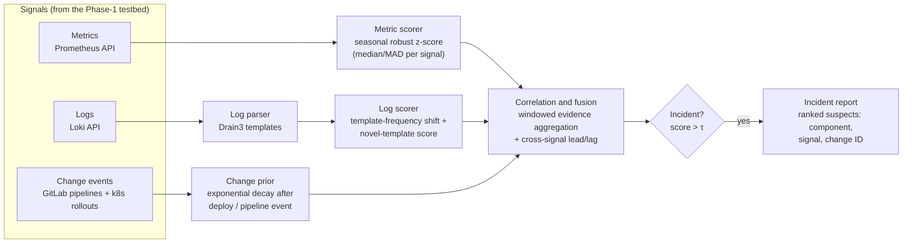

# Revised Research Scope: Response to Review Comments

> **Status:** draft for discussion with the guide. The Phase-1 platform in this repository is now
> positioned as the **experimental testbed**. The research contribution, the baselines and the
> evaluation below run on top of it.

## 1. Mapping of reviewer comments to this revision

| Reviewer comment | How this revision addresses it |
|---|---|
| "Mostly installation/configuration, no new method" | Section 3 defines a new method, **CAMSAC**: a change-aware multi-signal anomaly correlation model that fuses metrics, logs and pipeline/deployment events. |
| "Intelligence limited to PromQL/LogQL + thresholds" | Detection is done in Python outside Prometheus. Metric scores come from robust seasonal baselines, logs are parsed into templates (Drain) and scored for novelty and frequency shifts, and change events act as a causal prior. PromQL thresholds become the **baseline** to beat. |
| "Define a defensible problem and contribution" | Section 2: problem statement, research questions, hypotheses |
| "Baseline methods" | Section 5: B1 Prometheus threshold alerts, B2 metric-only statistical detection, B3 log-only detection, B4 ML baseline (Isolation Forest) |
| "Datasets, failure scenarios" | Section 4: a failure-injection harness with 8 fault types, labelled ground truth, and a public CI dataset (already collected) |
| "Experimental controls" | Section 6: fixed load profile, seeds, repetitions, warm-up/cool-down, fixed scrape interval, held-out runs |
| "Precision, recall, F1, MTTD, MTTR, FPR" | Section 7 defines each metric precisely, at event level |
| "Comparison against Prometheus threshold alerts" | B1 is implemented as real Prometheus alert rules, evaluated on the same injected runs |

## 2. Problem statement

In Kubernetes microservice environments, operators rely on **static, single-signal threshold alerts**, for example "error rate > 5 % for 2 min". These alerts are:

1. **Noisy.** Each signal fires independently, so one incident produces many alerts and false positives.
2. **Slow.** The thresholds are tuned conservatively to limit noise, which delays detection (high MTTD).
3. **Blind to change.** Most production incidents follow a deployment or config change, but alerts don't use CI/CD context. This slows diagnosis (high MTTR).

**Research question.** Can correlating metric anomalies, log anomalies and CI/CD change events in a shared time window detect failures more accurately and earlier than standard Prometheus threshold alerts? Can it also attribute those failures to the responsible change or component?

* **H1:** CAMSAC achieves a higher F1 and a lower false-positive rate than threshold alerts (B1) and than any single-signal detector (B2, B3).
* **H2:** CAMSAC reduces MTTD compared with B1, at an equal or lower FPR.
* **H3:** Change-awareness improves root-cause attribution accuracy (top-1 / top-3) for deployment-induced failures.

## 3. Proposed method: CAMSAC (Change-Aware Multi-Signal Anomaly Correlation)

**Step 1: per-signal scoring.** Each time window is 15 s, matching the scrape interval.
* *Metrics:* a curated set of RED and USE signals per service (request rate, error ratio, p95 latency, CPU, memory, restarts). Each value is scored with a robust z-score against a rolling, seasonality-aware baseline (median and MAD), which is insensitive to outliers.
* *Logs:* lines are parsed into templates with Drain3. The scores are the KL divergence of the template distribution against the baseline window, plus a novelty score for templates never seen before.
* *Change events:* each deployment, rollout or pipeline completion creates a prior `p(t) = exp(-(t - t_change)/λ)` attached to the affected service.

**Step 2: correlation and fusion.** This is the core contribution. Anomaly scores are first normalised to [0, 1] per signal. The incident score for service *s* at time *t* is a weighted combination with three parts:
* **Cross-signal agreement.** Several independent signals deviating together count far more than one. This suppresses single-signal noise and lowers the FPR.
* **Temporal precedence.** Signals that lead the others get more weight. Lead/lag is estimated by cross-correlation over the window.
* **Change prior.** A recent change on *s* or an upstream service raises the score.

The weights and τ are learned on *training* runs (logistic regression / grid search) and fixed for *test* runs.

**Step 3: attribution.** Suspects are ranked by `(change prior × earliest deviating signal × service)`, which produces an explainable root-cause list.

**Novelty claim.** Existing open-source tooling evaluates each signal in isolation, with static thresholds in Prometheus and LogQL rules in Loki. CAMSAC combines three things in one lightweight model that is reproducible on a laptop-scale cluster:
1. log-template statistics
2. metric deviation
3. CI/CD change context

The thesis also contributes an open, labelled failure-injection benchmark.

## 4. Dataset: failure-injection benchmark

The sample app gains fault-injection endpoints and env flags, and a Python harness (`experiments/inject.py`) schedules faults with random timing and records the ground truth in `labels.csv`: `run_id, fault, target, start, end`.

| # | Fault scenario | Injection mechanism | Signals expected to react |
|---|---|---|---|
| F1 | Error-rate spike | app flag `ERROR_RATE=0.4` | metrics (5xx), logs (error template) |
| F2 | Latency degradation | app flag `EXTRA_LATENCY=800ms` | p95 latency |
| F3 | CPU saturation | `/fault/cpu` busy loop, CPU throttling | CPU, latency |
| F4 | Memory leak → OOMKill | `/fault/leak`, grows until the limit | memory, restarts, logs |
| F5 | Pod crash loop | bad startup flag | restarts, pod phase, logs |
| F6 | Bad deployment | roll out a `sample-app:1.1-buggy` image via a simulated CI pipeline event | **change event**, errors, logs |
| F7 | Dependency failure | a downstream "payments" service scaled to 0 | errors, new log template |
| F8 | Config error | wrong env/ConfigMap rollout | change event, errors/logs |
| N | Normal operation | no fault, but with load variation and benign deploys | used to measure the FPR |

Benign deployments in the normal runs are essential. They test that the change prior does **not** create false alarms on its own.

Planned size: 8 faults × 10 repetitions × 2 intensities, plus ≥ 10 h of fault-free operation. Scrape data is exported from Prometheus/Loki into Parquet files per run, so all methods are evaluated **offline on identical data**.

The **GitLab pipeline CSV** already collected (`pipeline-collector/data/pipelines.csv`) is used as a secondary real-world dataset for the CI/CD signal: failure rates, duration anomalies and flaky-pipeline detection.

## 5. Baselines

| ID | Baseline | Implementation |
|---|---|---|
| **B1** | **Prometheus static threshold alerts** (industry standard) | Real alert rules in `prometheus/rules/baseline.yml`, for example error ratio > 5 % `for: 1m`, p95 > 500 ms `for: 2m`, CPU > 80 %, restarts > 0, memory > 90 % of limit. Firing times come from the `ALERTS` series. |
| B2 | Metric-only statistical detection | CAMSAC's metric scorer alone, with a per-signal threshold |
| B3 | Log-only detection | Drain3 + template-frequency scorer alone |
| B4 | ML multivariate baseline | Isolation Forest on the concatenated metric feature vector |
| Ablations | CAMSAC without the change prior, without logs, and without lead/lag weighting | Quantifies the contribution of each part |

## 6. Experimental design and controls

* **Fixed load profile:** the loadgen runs a defined pattern (constant plus a periodic step) with a fixed random seed. Every method sees identical data.
* **Fixed infrastructure:** pinned image versions, fixed resource limits, scrape interval 15 s, single-node minikube (2 CPU / 2.5 GB).
* **Warm-up 10 min** before the first injection. **Cool-down ≥ 10 min** between faults, with recovery confirmed by health checks.
* **Randomised** fault order and start time within each run, so methods can't learn the schedule.
* **Train/test split by run** (60/40). Weights and thresholds are tuned only on training runs.
* **Repetitions:** each configuration is repeated ≥ 10×. Results are reported as mean ± std with 95 % CI, and the comparison against B1 uses a paired Wilcoxon signed-rank test.

## 7. Evaluation metrics

Evaluation is at the **event (incident) level**, with a detection tolerance window of `[fault_start, fault_end + 2 min]`.

| Metric | Definition |
|---|---|
| Precision | TP / (TP + FP). A TP is ≥ 1 alarm inside a fault window. Repeated alarms for the same fault count once. |
| Recall | TP / number of injected faults |
| F1 | 2PR / (P + R) |
| False-positive rate | False alarms per hour of fault-free operation, also reported as FP / (FP + TN) over windows |
| **MTTD** | Mean of (first correct alarm time − fault start), over detected faults |
| **MTTR** | Mean of (service recovered − fault start). Recovered means the SLO is back within bounds. Measured with a scripted responder that acts on the alarm, for example by rolling back the attributed deployment or restarting the attributed pod. Earlier detection plus correct attribution then translates into shorter recovery. |
| Attribution accuracy | Top-1 / top-3 hit rate of the true faulty component/change in the ranked suspects |
| Alert volume | Alerts raised per incident (noise reduction) |

## 8. Mid-sem deliverables (revised)

| # | Deliverable | Status |
|---|---|---|
| 1 | Observability testbed (K8s, Prometheus, cAdvisor, KSM, Node Exporter, Loki, Grafana, CI collector) | ✅ done (this repo, 15/15 checks) |
| 2 | Problem statement, hypotheses, method design (this document) | ✅ draft |
| 3 | Fault-injection endpoints in the app and the injection harness with ground-truth labels | ⏳ next |
| 4 | B1 Prometheus threshold-alert baseline (rule file) + data exporter (Prometheus/Loki → Parquet) | ⏳ next |
| 5 | Initial failure-injection dataset (≥ 3 runs × 8 faults + normal data) | ⏳ |
| 6 | CAMSAC v0 (metric scorer + log scorer + fusion) and evaluation script | ⏳ |
| 7 | Initial comparative results table: B1 vs B2 vs CAMSAC v0 (P/R/F1, FPR, MTTD) | ⏳ |

## 9. Risks and limitations

* A single-node, laptop-scale cluster limits realism. This is mitigated by multiple fault types and by also running on the real GitLab CI data.
* Injected faults are cleaner than real incidents. This is mitigated by varying intensity and by benign deployments in the normal data.
* Comparing against a hand-tuned B1 needs fairness. The B1 thresholds are tuned on the same training runs, using the same data as CAMSAC.
